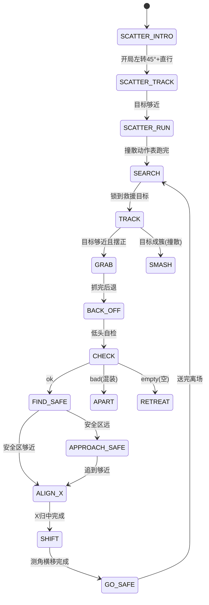

# 工创赛智能救援小车 —— 项目说明

> 赛道：智能+工程创新（智能救援）
> 主控：STM32F407VGT6（执行）+ 亚博 K230（视觉决策）
> 视觉主程序：`视觉代码/New_v8.py`（红蓝通用模板），比赛时按抽签颜色用 `Blue.py` 或 `Red.py`
> STM32 主工程：`小车代码/Final`
> 成本点：**仅 1 个 K230 模块 + 1 块 F4 主控**，无激光雷达/深度相机，视觉全部靠单目 RGB + YOLO11n

---

## 1. 系统概述

两轮差速小车 + 夹爪舵机 + 摄像头俯仰舵机，单目摄像头跑 YOLO11n 识别救援目标（黑/绿/橙）与安全区（蓝/红矩形），完成「搜索 → 抓取 → 低头自检 → 送入安全区」全流程。

**分工原则：K230 当大脑，STM32 当手脚。**

| 模块 | 职责 |
| --- | --- |
| K230（CanMV / MicroPython） | 跑 YOLO11n 检测、跑全部状态机与时序、发命令、收 ack |
| STM32（标准外设库） | 解析 12 字节串口帧、执行运动（速度/角度闭环 + 视觉追踪）、驱动舵机、回 ack |

**两条最关键的约束**（决定了所有状态机的写法）：

1. **STM32 有通信看门狗 `COMM_TIMEOUT_MS = 1500`**：超过 1.5 s 没收到有效帧就自动停车。所以任何持续动作（转/直行/后退/追踪），K230 **必须每帧重发**命令。
2. **`last_cmd` 去重**：STM32 收到与上一条相同的命令码直接忽略。所以连续两次同一条命令（比如两次 `CMD_TURN_L`），中间**必须插一帧 `CMD_STOP`** 清掉 last_cmd。

---

## 2. 硬件与资源

### 2.1 K230

| 项目 | 值 |
| --- | --- |
| 模型 | `/sdcard/gongchuangsai_yolo11n_det_320_v3.kmodel` |
| 模型输入 | 320 × 320 |
| 显示屏 | lcd 640 × 480（检测框坐标都在 640×480 空间） |
| UART | GPIO9=TXD、GPIO10=RXD |

**类别表（K230 侧）**

| id | 名称 | 用途 |
| --- | --- | --- |
| 0 | Black | 救援目标（优先级 2） |
| 1 | Blue | **危险物**（不可碰） |
| 2 | Green | 救援目标（优先级 1，第一次必须搬它） |
| 3 | Orange | 救援目标（优先级 3） |
| 4 | Safe_blue | 安全区（`SAFE_USE` 蓝） |
| 5 | Safe_red | 安全区（`SAFE_USE` 红） |

### 2.2 STM32F407VGT6 关键引脚

| 功能 | 引脚 | 备注 |
| --- | --- | --- |
| USART1 ↔ K230 | PA9(TX) / PA10(RX) | 115200 8N1 |
| USART2 ↔ 陀螺仪 | PA2(TX) / PA3(RX) | **115200**（不是 9600） |
| 电机 PWM | TIM1 CH1=PA8(左)、CH4=PA11(右) | 16.8 kHz |
| 编码器 | TIM3=PA6/PA7(左)、TIM4=PB6/PB7(右) | |
| 舵机 | TIM9 CH1=PE5(夹爪)、CH2=PE6(摄像头) | 50 Hz |
| 控制时基 | TIM5 1ms 中断 | 20ms 控制周期 |

### 2.3 舵机标定（`Final/Hardware/Servo.h`）

| 宏 | 值 | 含义 |
| --- | --- | --- |
| `GRIPPER_OPEN_DEG` | 120 | 夹爪张开 |
| `GRIPPER_CLOSE_DEG` | 87 | 夹爪闭合 |
| `CAM_UP_DEG` | 73 | 摄像头抬头（正常行驶） |
| `CAM_DOWN_DEG` | 35 | 摄像头低头（抓取/自检） |

---

## 3. 串口协议

### 3.1 下行帧（K230 → STM32），12 字节

```
[0] 0xAA | [1] cmd | [2] cls | [3..4] tx | [5..6] ty | [7..8] sx | [9..10] sy | [11] sum
```

`cls` 当 `cmd == CMD_CAM` 时是摄像头档位（0 抬头 / 1 低头）；当 `CMD_TURN_L/R` 时是角度（°）。

### 3.2 上行 ack（STM32 → K230），2 字节

```
[0] 0xBB | [1] cmd
```

STM32 在动作**执行完毕**（`Motion_GetMode() == MOTION_STOP`）才回 ack。K230 收到 `ack == cmd` 提前结束等待，否则走超时兜底。

### 3.3 命令码表

| 码 | 名称 | cls | 行为 |
| --- | --- | --- | --- |
| 0x01 | `CMD_ROT_LEFT` | — | 原地转圈找救援目标 |
| 0x03 | `CMD_FORWARD` | 类别 | 视觉追踪前进（tx/ty = 目标中心） |
| 0x04 | `CMD_GRAB` | 类别 | 停车 + 夹紧（回 ack） |
| 0x05 | `CMD_ROT_FIND` | — | 原地转圈找安全区 |
| 0x06 | `CMD_GO_SAFE` | 类别 | 视觉追踪安全区中心 |
| 0x07 | `CMD_DROP` | — | 松爪 + 后退 |
| 0x08 | `CMD_BACK` | — | 后退 |
| 0x09 | `CMD_CAM` | 0/1 | 摄像头抬头/低头 |
| 0x0A | `CMD_OPEN` | — | 只松爪（回 ack） |
| 0x0B | `CMD_STRAIGHT` | — | 定距直行 |
| 0x0C | `CMD_STOP` | — | 停车（也用来清 last_cmd） |
| 0x0E/0x0F | `CMD_TURN_L90/R90` | — | 左/右转 90° |
| 0x10/0x11 | `CMD_TURN_L/R` | 角度 | 左/右转指定角度 |
| 0x12 | `CMD_SPIN` | — | 原地转 360° |
| 0x13 | `CMD_STRAIGHT_FAST` | — | 高速直行（开局/撞散用） |

> `0x14 CMD_GO_SAFE_FAST` 曾用于 APPROACH，因 STM32 固件未实现而废弃，现已改回 `0x06`。

---

## 4. 视觉端状态机（核心）

完整状态机（19 个状态）。正常主链：



### 4.1 各状态说明

| 状态 | 阶段 | 行为 |
| --- | --- | --- |
| `SCATTER_INTRO` | — | 开局左转 45° → 直行 3.5s → 落爪 |
| `SCATTER_TRACK` | — | 追开局最近目标，够近进撞散 |
| `SCATTER_RUN` | — | 跑撞散动作表（左转撞→退→右转撞→退） |
| `SEARCH` | 0/1 | `CMD_SPIN` 转圈找目标，期间锁目标；转完直行再转 |
| `TRACK` | — | 追锁定目标；够近且成簇 → SMASH，孤立/可合搬 → GRAB |
| `SMASH` | 0~5 | 切低头 55° → 直行撞 → 后退重对准再撞（撞到散或超时） |
| `GRAB` | 0~4 | 低头 → 抬爪 → 前进对准 → 夹紧 → 左转 20° |
| `AVOID` | 0/1 | 抓取失败：后退脱离 + 左转避开 |
| `BACK_OFF` | — | 抓完后退 + 低头 |
| `CHECK` | 0/1 | 低头停稳 10 帧投票，多数表决 |
| `APART` | — | 抬爪→后退→放爪→前推→后退（把混装目标撞散） |
| `RETREAT` | — | 空框只后退，回 SEARCH 重找 |
| `REGRAB_GREEN` | 0~3 | 绿色保底放弃：后退→抬框→后退→落框→重找绿 |
| `FIND_SAFE` | 0~2 | `CMD_ROT_FIND` 转圈找自己区；超时用对方区补救 |
| `APPROACH_SAFE` | — | `CMD_GO_SAFE` 追安全区，追到够近交 ALIGN_X |
| `ALIGN_X` | 0~3 | 原地转把安全区中心 X 归到画面 320 |
| `SHIFT` | 0~3 | 测长边角 θ → 转(90-θ) → 直行横移 → 转回（见 §5） |
| `TO_OWN_SAFE` | — | 用了对方区补救后，掉头直行找自己区 |
| `GO_SAFE` | 0~9 | 对准→转→推→松爪→退→落爪→验证→离场（见 §4.3） |

### 4.2 目标选择（`pick_target`）

```python
pick_target(dets, dangers, green_done, safe)
  ├─ 排除落在安全区内的目标
  ├─ 排除"含橙/蓝的前后重叠"（occluded_bad，撞不开）
  ├─ green_done == False → 只保留 GREEN_CLS（第一次必须搬绿）
  ├─ 排除"抛弃名单"附近的目标（撞散 N 次失败后放弃）
  └─ 排序：距离优先，孤立目标优先，救援优先级做 tiebreaker
```

关键点：`green_done = False` 时只框绿；绿确认送入后才解锁黑/橙。`green_ever` 上锁后启用"一次多搬"（绿+黑配对合搬，最多 2 个）。

### 4.3 GO_SAFE 送入验证

| 阶段 | 行为 |
| --- | --- |
| 0 | `CMD_GO_SAFE` 对准安全区中心，`sy >= SAFE_Y_NEAR` 或超时 → 转送 |
| 1 | 转 ±`SAFE_DELIVER_DEG`(25°) |
| 2 | `CMD_STRAIGHT` 推进 `SAFE_PUSH_MS`(1700ms) |
| 3 | `CMD_OPEN` 松爪 |
| 4 | `CMD_BACK` 后退 `SAFE_BACK_MS`(2000ms) |
| 8 | `CMD_GRAB` 落爪 |
| 5 | 停车 10 帧验证 |
| 6 | 转 120° 离场 |
| 7 | 补抓（目标卡门口时触发） |

**phase 5 验证**：检查绿色目标是否落进安全区的**内切椭圆**：

$$r_x = \frac{sw}{2}\times0.75,\quad r_y = \frac{sh}{2}\times0.65,\quad \left(\frac{c_x-s_x}{r_x}\right)^2+\left(\frac{c_y-s_y}{r_y}\right)^2 \le 1$$

用椭圆而非矩形，是因为安全区在地面成像后是平行四边形，四角有"框内但不是安全区"的区域。

**补抓链**：目标卡门口（中心低于"下 1/4 线"）→ `regrab_after_safe=True` → 跳 TRACK 追近 → GRAB 全流程重新抓 → 抬头后退 → 回 ALIGN_X 重新对准+横移再送。最多补抓 `SAFE_RETRY_MAX=2` 次，还失败就走离场。

---

## 5. 长边拟合与归中（核心算法）

> 这一步解决的是：**把车摆到安全区正前方、正对长边**，保证黑/绿能推进左半区、橙推进右半区。

### 5.1 问题：只对准中心还不够

`ALIGN_X` 只把安全区**中心 X** 归到画面 320（车正对中心）。但安全区是地面上一个**带朝向的矩形**，长边相对车轴可能有个夹角 θ。若 θ≠0，车正对中心却是斜着切长边，物块会被推偏。

### 5.2 第一步：扫出长边（`safe_long_edge`）

在安全区框里开 ROI（只取**下沿附近**，避免扫进远处地板），**逐列从下往上找第一个紫色像素**（`B-G>20 且 R-G>0 且 B>60`），得到每列最下方的命中点，再对这些 `(x,y)` 做最小二乘拟合直线 `y = a·x + b`。

**面对角（V 字）处理**：当车斜对安全区一角时，逐列扫描会同时扫到「长边」和「宽边」两条边，形成 V 字，单线拟合会错。做法是**分段拟合找拐点**：

1. 先整体拟合，算总残差 `tot0`；
2. 穷举切分点 k（每段至少 2 点），左右两段各拟合，找总残差最小的 `best_k`；
3. 若 `best_tot / tot0 < SPLIT_GAIN(0.5)`，判定有 V 字拐点，切两段取**斜率绝对值小**的那段当长边（宽边被透视压扁，近竖直，|a| 大）。

最后对选中的那段做两轮离群点剔除（`FIT_TOL=4.0`），得到稳定的斜率 a。

### 5.3 第二步：图像斜率 → 地面偏角（`shift_geom`）

拟合直线在**图像**里的斜率 a 不能直接当角度，要经两步透视还原：

```
① 中心列 x=160 反解距离：  y_c = (a·160 + b)·1.5
                          Zq = SH_FH / (y_c - SH_YH)          # 车到近长边距离(米)
② 去各向异性 + 透视还原：  tan(θ_disp) = SH_ASPECT · |a|      # 0.75 = 320→640 的斜率换算
                          tanθ = (Zq / SH_CAM_H) · tan(θ_disp)
                          θ = atan(上式)，a<0 则 θ 取负
```

| 参数 | 值 | 含义 |
| --- | --- | --- |
| `SH_FH` | 111.8 | 垂直 f·h（两点标定） |
| `SH_YH` | -37.2 | 地平线 y（抬头时为负，正常） |
| `SH_CAM_H` | 0.18 | 相机镜头离地高度 (m) |
| `SH_ASPECT` | 0.75 | 320→640 斜率换算 |

`θ` 就是安全区长边相对车轴的真实偏角（带符号）。`|θ| > SH_MAX_TH(70°)` 认为拟合抓到短边/角，直接跳过横移。

### 5.4 第三步：算横移量（`shift_S`）

车要横移到「安全区中线」，需沿长边方向平移：

$$S = Zq \cdot \sin|\theta| + \frac{SH\_SAFE\_W}{2}\cdot\tan|\theta|$$

其中 `SH_SAFE_W=0.36` 是安全区短边宽度（卷尺量）。θ→0 时退化为 `S ≈ (Zq + W/2)·θ`。

**执行三段**（SHIFT 状态机）：

```
phase 1  转 (90 - θ)        车头垂直于长边
phase 2  直行 S 距离         沿长边方向横移
phase 3  转回 90°           恢复朝向（净转角 = -θ）
```

横移时长 `sh_dms = 1000·S / SH_V`（`SH_V=0.3` 为实测直行速度）。最后乘 `SH_S_GAIN(1.3)` 整体补偿，|θ|>30° 再乘 `SH_BIG_GAIN`。

**采样稳定化**：进入 SHIFT 先 `SH_SAMPLE_SETTLE_MS=400` 等车停稳（刚转过来有惯性），再滑窗取 5 帧中位数；最近 3 帧 θ 极差 < `SH_STABLE_TH=2.0` 可提前锁定，避免一直等满 `SH_MEAS_MS=700`。

### 5.5 ALIGN_X 归中

```python
err = sx - 320            # 安全区中心偏离画面中心的像素
# |err| <= AX_TOL_PX(20) → 完成进 SHIFT
# 否则原地转 err·AX_GAIN(0.09)°，最多 AX_MAX_ITER(2) 次
```

先 X 归中（把车正对安全区中心），再 SHIFT 测角横移（把车摆到正对长边），两步合起来完成"归中"。

### 5.6 标定流程

1. **SH_FH / SH_YH（两点标定，车不上电）**：`EDGE_ONLY=True`，屏幕实时显示 θ。安全区正对车放，量两个距离 D1、D2，读屏幕 sy1、sy2：

$$\frac{1}{D} = \frac{s_y - SH\_YH}{SH\_FH} \quad\Rightarrow\quad 两点解出 SH\_FH、SH\_YH$$

2. **SH_CAM_H / SH_SAFE_W**：卷尺量相机离地高度、安全区短边宽度。
3. **SH_V**：直行 2s 量距离 ÷ 2。
4. **SH_S_GAIN**：跑一次横移，量实际横移 vs 理论 S，按比例微调。

---

## 6. STM32 执行端（`小车代码/Final`）

### 6.1 文件结构

| 文件 | 内容 |
| --- | --- |
| `Hardware/Comm.c/.h` | 12 字节帧解析、环形缓冲、校验、`COMM_TIMEOUT_MS=1500` |
| `Hardware/App.c/.h` | `Cmd_Dispatch` 命令分发（`last_cmd` 去重）、`App_Poll` 回 ack |
| `Hardware/Motion.c/.h` | 运动闭环（视觉追踪 / 直行 / 转向 / 后退 + 陀螺仪航向保持） |
| `Hardware/Encoder.c/.h` | 编码器（TIM3=左、TIM4=右） |
| `Hardware/Gyro.c/.h` | 陀螺仪帧解析 + 累加式测角 |
| `Hardware/Motor.c/.h` | PWM 输出（TIM1） |
| `Hardware/Servo.c/.h` | 夹爪/摄像头舵机（TIM9） |
| `Hardware/Serial.c/.h`、`Wireless.c/.h`、`PWM.c/.h` | 底层外设 |
| `SYSTEM/` | PID、Timer（TIM5 时基）、delay、sys |
| `USER/main.c` | 初始化 + 主循环 |

> `OBJ/` 是 Keil 编译中间文件（.o），**不要提交**。

### 6.2 关键标定值（`Motion.c`）

| 宏/变量 | 值 | 含义 |
| --- | --- | --- |
| `s_BaseSpeed` | 49 | 直行基础速度（counts/20ms） |
| `s_SpeedFast` | 75 | 高速直行档 |
| `s_TurnSpeed` / `s_BackSpeed` | 49 | 转向 / 后退速度 |
| `TRACK_CENTER_X` | 320 | 画面中心 |
| `TRACK_DEADBAND` | 15 | 追踪死区（±px） |
| `TRACK_KP` | 0.10 | 像素偏差 → 差速 |
| `TRACK_OUT_MAX` | 15 | 差速限幅 |
| `TURN_STOP_MARGIN_DEG` | 7.0 | 提前断电抵消惯性 |
| `YAW_SIGN` | -1.0 | 陀螺仪方向 |

### 6.3 最容易踩的坑

1. **看门狗 1500ms**：持续动作必须每帧重发命令，否则被 `COMM_TIMEOUT_MS` 掐断。
2. **`last_cmd` 去重**：连续两次同命令中间必须插 `CMD_STOP`。
3. **转向少 7°**：`TURN_STOP_MARGIN_DEG=7.0` 提前断电，命令 90° 实际约 83°。
4. **转向有 ~230ms 陀螺仪标定阻塞**：K230 侧等待时间要算进去。
5. **`MOTION_STRAIGHT` 已带航向保持**（陀螺仪，1.5° 死区），横移跑偏先怀疑 `pidYaw` 增益和打滑。
6. **`Yaw()` 跨 ±180° 跳变**：必须累加式测角，不能直接做差。

---

## 7. 文件结构与上传建议

### 7.1 需要提交的核心文件

```
README.md
视觉代码/
  New_v8.py          # 红蓝通用主程序（模板）
  Blue.py            # SAFE_USE=蓝
  Red.py             # SAFE_USE=红
  YOLO模型/          # 训练好的 .kmodel（放 sdcard 用）
小车代码/
  Final/             # STM32 主工程（删掉 OBJ/）
3D建模文件/          # 夹爪/支架
PCB/                 # 外设拓展板
创新环节_离线训练到kmodel全流程.txt   # 训练流程文档
```

### 7.2 建议不提交（或加 .gitignore）

| 目录/文件 | 原因 |
| --- | --- |
| `发票/` | 个人隐私 |
| `报道文件/` | 含个人信息 |
| `STM32F407VGT6芯片资料/` | 2.4GB 官方资料，版权 |
| `runs/` | 101MB YOLO 训练输出（可再生成） |
| `tmp/`、`.dsh-office-*` | 临时文件 |
| `yolo11n.pt` | 5.6MB 预训练权重（官网可下） |
| `gongchuangsai_yolo11n_det_320.kmodel` / `_v2.kmodel` | 历史模型，只留 v3 |
| `小车代码/` 里的 `Control`/`Control_v2`/`Control_v2_Turn`/`ALL_test`/`M0单轴陀螺仪`/`PID速度闭环`/`PWM驱动电机`/`基础源码` | 历史/实验工程，只留 `Final` |
| 各 Keil 工程的 `OBJ/`、`Listings/`、`*.uvguix.*`、`DebugConfig/` | 编译中间文件 |

### 7.3 建议的 .gitignore

```gitignore
# 编译产物
**/OBJ/
**/Listings/
**/DebugConfig/
*.uvguix.*
*.o

# 隐私/资料/临时
发票/
报道文件/
STM32F407VGT6芯片资料/
tmp/
runs/
.dsh-office-*

# 大文件（预训练权重、历史模型）
yolo11n.pt
gongchuangsai_yolo11n_det_320.kmodel
gongchuangsai_yolo11n_det_320_v2.kmodel

# 历史工程（只留 Final）
小车代码/Control/
小车代码/Control_v2/
小车代码/Control_v2_Turn/
小车代码/ALL_test*/
小车代码/M0单轴陀螺仪/
小车代码/PID速度闭环/
小车代码/PWM驱动电机/
小车代码/基础源码/
```

---

## 8. 关键教训（浓缩）

1. **看门狗 1500ms + last_cmd 去重**是所有状态机写法的前提：持续动作每帧重发，连续同命令插 STOP。
2. **参数不要两处定义**：同名参数在文件里出现两次会静默覆盖，排查半天才发现。
3. **`except` 里必须 `sys.print_exception(e)`** 且恢复抬头+停车，否则车会带着低头姿态乱冲。
4. **距离度量只用安全区中心 y**：`D = SH_FH/(sy - SH_YH)` 是唯一"一变量只随距离变"的量；用 bbox 宽/长边像素长都会随角度乱跳。
5. **长边拟合面对角要分段**：单线拟合 V 字必错，穷举切点取残差最小的分段，再取斜率小段当长边。
6. **采样要等停稳**：车刚转过来有惯性，采前 5 帧会测到滑行中的假角度；先 settle 再滑窗取中位数。
7. **横移量有保险丝**：`SH_S_MAX` 截断会让增益调到天都没反应，先确认没顶到上限再谈标定。
8. **`TURN_STOP_MARGIN_DEG=7` 让转向系统性偏小**：角度补偿在 K230 侧做，别在固件里反复改。
